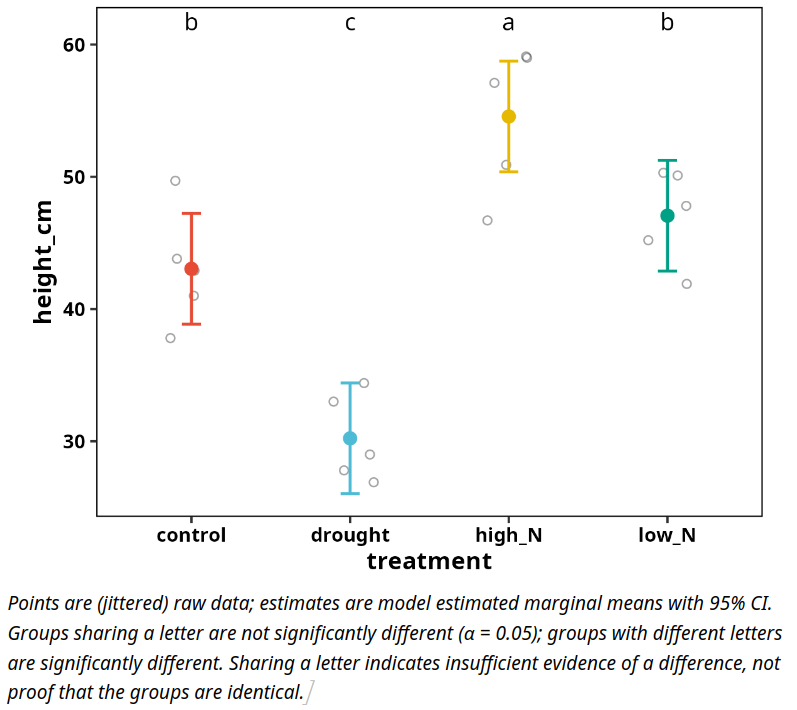

# rfriend

[](https://CRAN.R-project.org/package=rfriend)
[](https://CRAN.R-project.org/package=rfriend)
[](https://www.R-project.org/Licenses/GPL-3)

**From raw data to a reviewer-ready statistics report in one line of R.**

`rfriend` runs the test, checks the assumptions, transforms the data when
needed, does the post hoc comparisons, and writes the result to Word, PDF,
Excel or R Markdown. Tables come with compact letter displays and figures
are publication-ready `ggplot2` objects you can restyle.

It is built for people who need sound statistics but do not live in R:
MSc and PhD students writing a thesis, researchers in plant, life and
environmental sciences, and companies that analyse experiments a few times
a year.

Full documentation: <https://delde001.github.io/rfriend/>

<p align="center">
  
</p>
---

## Try it in 60 seconds

```r
install.packages("rfriend")
library(rfriend)

# Not sure which test to use? Ask the wizard, and let it run the answer.
f_stat_wizard(Sepal.Length ~ Species, data = iris, run = TRUE)

# A real design: a randomised complete block field trial with repeated
# measures (bundled teaching dataset), analysed with a mixed model and
# written to a Word report.
data(plant_trial)
plant_trial$time_f <- factor(plant_trial$time_weeks)

f_lmer(height_cm ~ treatment * time_f + (1 | block/plant_id),
       data        = plant_trial,
       output_type = "word")
```

The report contains the assumption checks, the Type III table, the
estimated means with compact letters, and the effect and interaction plots.

---

## What rfriend does for you

**Choose the test.** `f_stat_wizard()` (beta) reads your formula and data,
checks variable types, normality and variance, and recommends an `f_`
function as ready-to-run code.

**Run the test, properly.** Each test function checks its assumptions,
offers a Box-Cox or bestNormalize transformation when they fail, runs post
hoc comparisons, and handles several response variables in one call
(`y1 + y2 ~ treatment`), with a note on multiple testing.

| Question | Function |
|---|---|
| Two groups | `f_t_test()`, `f_wilcox_test()` |
| More than two groups | `f_aov()`, `f_kruskal_test()` |
| Repeated measures, blocks, nesting | `f_lmer()`, `f_friedman()` |
| Continuous predictors | `f_lm()` |
| Counts, proportions, binary outcomes | `f_glm()` |
| Categorical association | `f_chisq_test()` |
| Which model fits best | `f_model_compare()` |

**Explore and prepare your data.** `f_summary()`, `f_scan()` (density,
boxplot and QQ panel per variable), `f_corplot()`, `f_boxplot()`,
`f_hist()`, `f_qqnorm()`, `f_outliers()`, `f_remove_outliers()`,
`f_boxcox()`, `f_bestNormalize()`, `f_factors()` and `f_long()`.

**Everyday helpers.** `f_clear()` clears the workspace and restarts R,
`f_setwd()` sets the working directory to the current script,
`f_example_data()` gives access to bundled example files, plus
`f_open_file()`, `f_pander()`, `f_rename_columns()`, `f_rename_vector()`,
`f_load_packages()` and `f_theme()`.

---

## More examples

```r
# Summary table of a data frame
f_summary(plant_trial)

# Two responses analysed in sequence, saved to Word
f_aov(Sepal.Width + Sepal.Length ~ Species,
      data        = iris,
      output_type = "word")

# Boxplots of several variables split by two factors
f_boxplot(hp + disp ~ gear * cyl,
          data        = mtcars,
          output_type = "word")

# Box-Cox transformation of a single variable
transformed <- f_boxcox(plant_trial$biomass_g)

# Bundled example files
f_example_data()                                  # list files
path <- f_example_data("plant_trial_raw.csv")     # path to one file
raw  <- read.csv(path)
```

---

## Learn rfriend

A step-by-step video course takes you from installing R to a complete,
defensible thesis analysis with `rfriend`. Details: [rfriend.subscribepage.io].

Workshops for departments, graduate schools and companies are available
on request: <plantmind@proton.me>.

---

## Installation

`rfriend` requires R (>= 4.4.0). PDF and Word output need Pandoc
(>= 3.2), which is bundled with RStudio.

```r
install.packages("rfriend")                       # CRAN release

# install.packages("devtools")
devtools::install_github("delde001/rfriend")      # development version
```

---

## Citing rfriend

```r
citation("rfriend")
```

---

## Known issues

- On loading you may see messages about S3 method overwrites
  (`nobs.fitdistr`, `nobs.multinom`) caused by imported packages
  (`MuMIn`, `rstatix`). They do not affect results.

---

## Contributing

Bug reports and feature requests are welcome on
[GitHub](https://github.com/delde001/rfriend/issues). Pull requests should
be tested locally, documented with roxygen2, and follow the existing style.

## License

GPL-3. See <https://www.R-project.org/Licenses/GPL-3>.

## Contact

Dr. ir. Sander H. van Delden, <plantmind@proton.me>
